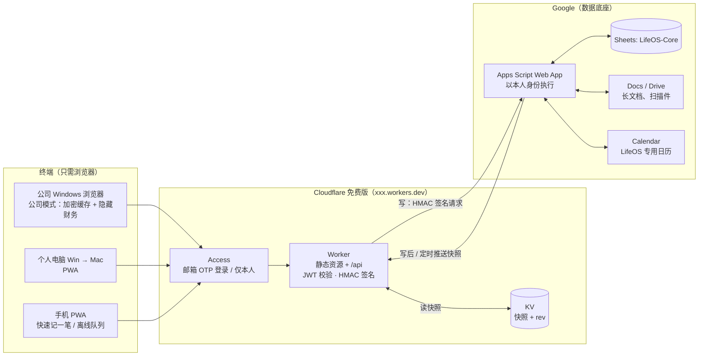
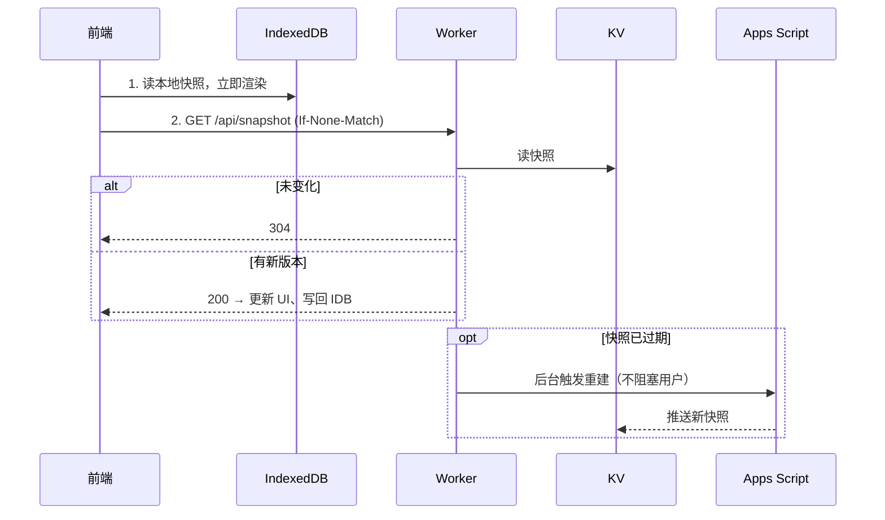
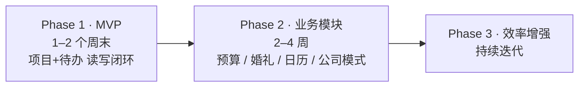

# Personal LifeOS Dashboard · 架构设计方案 v1.1

> 定位：**Google 生态做数据底座 + 一个打开就快的私人 PWA 看板**，**仅本人使用、零费用**。
> 本文只做架构设计，不含实现代码；第 6 节是给后续开发模型的工程约定，第 7 节是已拍板的决策记录。

**v1.1 相对 v1 的变更**
- 只给本人用：去掉家人角色、共享表格、按角色裁剪数据、字段级冲突合并；
- 零费用：不买自定义域名，使用 Cloudflare 免费子域名 `*.workers.dev`；托管从 Pages 改为 **Workers + Static Assets**（Cloudflare 当前主推，Access 可一键保护整个 Worker）；
- 时间层只接 Google Calendar，不再接 Google Tasks；
- 公司电脑策略已拍板：本地缓存加密，预算/财务板块默认隐藏。

---

## 1. 架构对比与最终推荐

### 1.1 三条路线对比（单人视角）

| 维度 | A. Google Sheets 原生 | B. 静态前端 + Apps Script | C. 静态前端 + Supabase/Firebase + Drive |
|---|---|---|---|
| 运维 | 零 | 很低 | 要管两套数据和同步 |
| 打开速度 | 3–8 秒，手机端更慢 | 裸用 2–5 秒 → **加缓存层后不到 1 秒** | 快 |
| 手机快速记事 | 差 | 好（PWA） | 好 |
| Google 联动（Docs/Drive/Calendar） | 原生 | **最好**：Apps Script 以本人身份直接操作，无需 OAuth 审核 | 要自己申请 OAuth、做同步 |
| 公司电脑隐私 | 必须登录个人 Google | 可做到**不登录 Google** | 可以 |
| 数据可读性 | 最好 | 最好：数据始终在 Sheets 里 | 两份数据，以哪份为准是长期难题 |
| 主要坑点 | 没法定制 | CORS、冷启动、部署版本、配额 | Supabase 免费项目闲置 7 天会被暂停；双写一致性 |

**结论**：选 B，并用 Cloudflare 补齐 B 的三个硬伤（冷启动慢、CORS 别扭、鉴权难做）→ 即下面的 **B+**。

### 1.2 最终推荐：B+

**“静态 PWA（Cloudflare Workers）+ Cloudflare Access 登录 + Apps Script + Google 数据底座”**

| 组件 | 职责 | 费用 |
|---|---|---|
| **Cloudflare Workers + Static Assets** | 托管前端（全部资源打包后同源提供，**零外部 CDN**）+ 同一个 Worker 提供 `/api/*` | 免费（静态资源请求不计数；API 每天 10 万次） |
| **Cloudflare Access** | 整个站点前面的登录：邮箱验证码 OTP（公司电脑用）或 Google 登录（个人设备可选）；只放行本人邮箱 | 免费（≤50 人），**需绑定支付方式但不扣费** |
| **Workers KV** | 存一份最新数据快照，打开时约 50ms 返回 | 免费（每天读 10 万次 / 写 1000 次） |
| **Apps Script**（以本人身份执行） | 唯一能接触 Google 数据的后端：读写 Sheets、按模板建 Doc/文件夹、同步 Calendar、定时备份 | 免费 |
| **Google Sheets / Docs / Drive / Calendar** | 唯一数据源 | 免费（个人账号 15GB） |

Worker 只做 4 件事：① 校验 Access 签发的 JWT，确认是本人；② 用服务端密钥（HMAC）签名后调用 Apps Script，**密钥不进浏览器**；③ 前端和 API 同源，**没有 CORS 问题**；④ 读写 KV 快照。

### 1.3 架构图



---

## 2. 数据分层与表结构设计

### 2.1 各组件边界

| 层 | 组件 | 存什么 | 不存什么 |
|---|---|---|---|
| 结构化索引层 | **Google Sheets** | 所有可列表、可筛选、可统计的记录：项目、待办、预算流水、专项子表、资源索引 | 长文本、附件、密码、证件号 |
| 长内容层 | **Google Docs** | 项目说明、纪要、婚礼流程、复盘 | 状态和数字（这些写在 Sheets 里，Docs 只放链接） |
| 文件层 | **Google Drive** | 合同、发票、扫描件、图片 | —— |
| 时间层 | **Google Calendar** | 有具体时间的提醒 | 不当作数据源，只是 Sheets 的**单向投影** |

**串联规则**：
1. **Sheets 是唯一的数据源和目录**：项目行带 `doc_url` / `folder_url`；文件在 `Resources` 表登记一行，指向 Drive 的 `file_id`。
2. **Calendar 单向投影**：任务有 `remind_at` 且 `sync_calendar=TRUE` 时，在专用的 “LifeOS” 日历里生成事件，事件 ID 回写到 `calendar_event_id`，重复同步不会产生重复事件；任务完成或删除时同步更新事件。
3. **新建项目自动搭好脚手架**：按模板复制 Doc、新建 `/LifeOS/Projects/{year}-{slug}/` 文件夹，链接回写到项目行。

### 2.2 Spreadsheet 划分

| Spreadsheet | 包含的表 |
|---|---|
| `LifeOS-Core` | `Projects`、`Tasks`、`Ledger`、`Resources`、`W_Guests`、`W_Rooms`、`_Meta`、`_Log` |
| `LifeOS-Archive` | 已归档的行（每年迁移一次） |

> 以后如果需要给家人看某个专项，再把那几张表拆到一个独立的 Spreadsheet 里分享即可，结构不受影响。

### 2.3 通用字段（所有业务表都有）

| 字段 | 说明 |
|---|---|
| `id` | 前端生成 ULID（按时间排序、离线不冲突），唯一主键，**不依赖行号** |
| `created_at` / `updated_at` | ISO 字符串，单元格格式为纯文本 |
| `updated_by` | `web` / `mobile` / `sheets-ui` / `gas-trigger`（记录来源设备） |
| `version` | 整数，每次写入 +1 |
| `deleted` | 软删除 |

### 2.4 核心表最小字段

**`Projects` 项目总览**：`title`、`area`（`life`/`work`/`personal`…，可在 `_Meta` 扩展）、`kind`（`stage` 阶段性 / `ongoing` 长期）、`status`（`idea`/`active`/`paused`/`done`/`archived`）、`priority`（`P0`–`P3`）、`start_date`、`target_date`、`next_action`、`module`（专项模块，如 `wedding`）、`sensitive`（公司模式下隐藏）、`doc_url`、`folder_url`、`tags`、`sort`

**`Tasks` 全局待办**：`title`、`notes`、`project_id`（可空）、`status`（`inbox`/`todo`/`doing`/`waiting`/`done`/`cancelled`）、`priority`、`due_date`、`remind_at`、`context`（`work`/`home`/`errand`，公司模式按它过滤）、`sync_calendar`、`calendar_event_id`、`completed_at`

**`Ledger` 预算台账（计划和实际放一张表）**：`date`、`project_id`、`kind`（`plan` 预算 / `actual` 实际）、`category`、`item`、`amount`、`currency`、`direction`（`out`/`in`）、`pay_status`（`planned`/`deposit`/`paid`/`refunded`）、`method`、`vendor`、`receipt_file_id`
> 预算 vs 实际 = 按 `project_id + category` 分组相减，**由前端计算**，数据表里不写公式。

**`Resources` 资源索引**：`project_id`、`title`、`type`（`doc`/`file`/`scan`/`link`）、`url`、`drive_file_id`、`sensitive`、`tags`

**专项示例：婚礼排房**
- `W_Guests`：`name`、`side`、`group`、`relation`、`rsvp`、`headcount`、`need_room`、`arrive_date`、`depart_date`、`room_id`、`dietary`、`notes`
- `W_Rooms`：`hotel`、`room_no`、`room_type`、`beds`、`capacity`、`checkin`、`checkout`、`price`、`status`
- 关系：`W_Guests.room_id → W_Rooms.id`；超员、日期冲突检查由前端计算。

**`_Meta`（扩展的关键）**：`table`、`column`、`type`（`text`/`enum`/`date`/`money`/`ref`/`bool`/`url`）、`enum_values`、`label_zh`、`required`、`order`。前端据此动态渲染表单和列表；以后加新专项（装修、考证…）= 新建 `X_*` 表 + 在 `_Meta` 登记。

**`_Log`**：每次写入记一行（`ts`、`device`、`mutation_id`、`table`、`row_id`、`patch`、`old_values`），用于审计、去重和**找回被覆盖的旧值**。

### 2.5 Sheets 当数据库的铁律

1. 一张工作表一张表，第 1 行是表头，**表头行设为受保护区域**；
2. 代码**按表头名映射列**，不按列号（手动加列、排序都不会出问题）；
3. 数据表不合并单元格、不写公式，汇总交给前端；
4. 日期、电话、ID 列设为纯文本格式；
5. 枚举列加“数据验证”下拉框，直接在 Sheets 里编辑也不会写入脏数据。

---

## 3. 性能、部署与安全方案

### 3.1 秒开：四级缓存 + 后台刷新

| 层级 | 位置 | 时延 | 作用 |
|---|---|---|---|
| L0 | Service Worker 预缓存 | ~0ms | 应用外壳全部本地化，离线也能打开 |
| L1 | IndexedDB | <50ms | 上次的数据快照 + 待发送的写操作队列（outbox） |
| L2 | Workers KV | ~50–150ms | 边缘快照（带 `rev` / `ETag`） |
| L3 | Apps Script → Sheets | 2–5s | 数据源，**不在用户操作的关键路径上** |



**快照保持新鲜**：
- 通过看板写入 → Apps Script 写完立即重建并推送快照；
- 直接在 Sheets 里编辑 → `onChange` 触发器标记“脏”，每 10 分钟的定时触发器检查到脏标记就重建；
- 看板里有“强制刷新”按钮，直接拉一次 Apps Script。

数据量估算：几千行，gzip 后 <300KB，**MVP 用全量快照 + ETag**，不做增量同步。

### 3.2 写入与冲突（单人简化版）

单人场景下，冲突只会出现在“手机离线时记了一笔，同时电脑上改了同一条”这种极少数情况，因此：

1. **乐观更新 + outbox 队列**：前端立即更新 UI，写操作进入 IndexedDB 队列，在线时立即发送，离线时联网后自动重放；
2. **只发改动的字段**：`{ mutation_id, table, row_id, op, base_version, patch }`；
3. **服务端**：`LockService` 串行化写入；用 `mutation_id` 去重（重试幂等）；按 `id` 定位行；
4. **冲突策略 = 字段级“最后一次修改为准”**：直接应用 patch，`version+1`；若 `base_version` 落后，把被覆盖字段的旧值写入 `_Log.old_values`，前端给个轻提示“已覆盖另一设备的修改（可在日志找回）”。**不做冲突弹窗。**
5. **KV 最终一致（约 60 秒）**：快照带单调递增的 `rev`，前端丢弃比本地更旧的快照。

### 3.3 部署（全部免费）

| 组件 | 方式 |
|---|---|
| 前端 + API | 一个 Cloudflare Worker（Static Assets + `/api` 路由），GitHub 仓库 push 到 `main` 自动部署（Workers Builds） |
| 域名 | 免费子域名 `lifeos.<你的账户名>.workers.dev`，**不买域名** |
| Apps Script | `clasp` 管理源码（仓库 `/gas`），**固定 Deployment ID**，每次发布更新同一个部署，保证 `/exec` URL 不变 |
| 密钥 | `GAS_HMAC_SECRET` 存 Cloudflare Secrets 和 Apps Script Script Properties 里，**绝不进仓库** |

### 3.4 访问鉴权（三层）

1. **Cloudflare Access**：在 Worker 上开启 “Protect this Worker behind Access → All traffic”（覆盖 `workers.dev` 和预览地址），策略只放行本人邮箱。会话时长：公司电脑 12 小时，个人设备 30 天。
2. **Worker 校验 JWT**：校验 `Cf-Access-Jwt-Assertion` 签名，且 email 必须等于本人（防止 Access 配置误改后裸奔）。
3. **Apps Script 校验 HMAC**：Web App 设为 “Anyone”（服务端调用必需），每个请求带 `HMAC(secret, timestamp + body)`，时间窗口 5 分钟。即使 `/exec` URL 泄露也调不通。

> 兜底：私密 Spreadsheet 从不分享；Drive 里的文件在看板里只放链接，打开仍需 Google 登录。

### 3.5 公司电脑隐私（已拍板）

| 措施 | 说明 |
|---|---|
| 不登录个人 Google | 用 Access 邮箱 OTP 登录看板；Drive 链接打不开是有意为之 |
| **设备类型** | 首次登录时选择“个人设备 / 公司设备”，存在本机 |
| **公司设备：加密缓存** | IndexedDB 里的数据用 PIN 派生的密钥（WebCrypto PBKDF2 + AES-GCM）加密；每次打开输入短 PIN 解锁；连续输错清空本地数据 |
| **公司设备：隐藏财务** | 默认隐藏 `Ledger`、`sensitive=TRUE` 的项目和资源；快照在 Worker 端就按设备类型裁剪，**这些数据根本不会下发到公司电脑** |
| 一键遮挡 | 快捷键模糊整个页面 |
| 数据最小化 | 证件号、密码、银行卡号永不入库（交给密码管理器）；默认公司能看到你在公司电脑上的一切流量 |

> 实现提示：设备类型由前端声明，Worker 根据请求头裁剪数据。这是隐私上的“少下发”措施，不是安全边界——安全边界是 Access。

### 3.6 备份

1. Sheets 自带的版本历史；
2. Apps Script 每周定时：复制到 `/LifeOS/Backups/` + 导出 JSON，保留最近 12 份；
3. 个人电脑上一键导出 JSON/CSV；
4. 每半年做一次 Google Takeout。

> ⚠️ 数据备份不要提交到代码仓库。

---

## 4. 分阶段落地路线图



### Phase 1：最小闭环（MVP）

**范围**：
- Google：建好 `LifeOS-Core`（`Projects`、`Tasks`、`_Meta`、`_Log`）；Apps Script 实现 `snapshot`、`mutate` 两个动作 + HMAC 校验；
- Cloudflare：Worker（静态资源 + `/api` + JWT 校验 + KV 快照）+ Access（仅本人）；
- 前端 PWA：**总览页**（进行中的项目 + 今天/逾期待办）、**待办列表**（筛选、完成、编辑）、**快速新增**（手机底部大按钮）；IndexedDB 缓存 + outbox；同步状态提示。
- 不做：预算、婚礼、日历、公司模式（但缓存层预留加密开关）。

**验收标准**：

| # | 验收项 | 标准 |
|---|---|---|
| 1 | 二次打开 | 手机和电脑上带数据首屏 **< 1 秒** |
| 2 | 首次冷启动 | 清空缓存后 **< 3 秒**出数据 |
| 3 | 写入 | 手机新增待办 → **5 秒内**出现在 Sheets 里 |
| 4 | 反向同步 | Sheets 里改一行 → 点刷新立即可见；不操作 ≤ 10 分钟自动可见 |
| 5 | 离线 | 飞行模式下新增 2 条 → 恢复网络后自动补发、不重复 |
| 6 | 鉴权 | 未登录访问 `/api/*` 被拒；不带签名直接调 Apps Script `/exec` 被拒 |
| 7 | 零外部依赖 | DevTools Network 里除登录跳转外全部同源 |
| 8 | 公司电脑 | 公司 Windows 浏览器不装软件、不登录 Google 即可完成 1–6 |

### Phase 2：业务模块
1. **预算台账**：`Ledger`、预算 vs 实际、票据关联 Drive；
2. **婚礼模块**：宾客/RSVP、**拖拽排房** + 超员/日期冲突提示、婚礼待办和倒计时；
3. **日历投影**：`remind_at` → LifeOS 日历；
4. **资源索引**：新建项目自动生成 Doc 和文件夹；
5. **公司模式**（加密缓存 + 隐藏财务）+ **每周自动备份**。

**验收**：婚礼预算和排房完全在看板内完成；公司设备上抓包看不到 `Ledger` 数据；从备份恢复演练一次。

### Phase 3：效率增强
- iOS 快捷指令 / Android 快捷方式“一键记一笔”（Access Service Token，免费）；
- 全局搜索、电脑端键盘快捷键；
- 每日摘要邮件（Apps Script MailApp）、周回顾页；
- 基于 `_Meta` 的通用模块（新增专项不写代码）；
- 每年归档；换 Mac 时无需任何迁移。

---

## 5. 关键风险与避坑清单

| # | 坑 | 规避 |
|---|---|---|
| 1 | **Apps Script CORS**：浏览器直接 fetch 报错，不支持预检请求 | 浏览器永远不直接调 Apps Script，由同源 Worker 在服务端调用 |
| 2 | **冷启动 2–5 秒** | L0–L2 缓存 + 后台刷新 |
| 3 | **部署版本陷阱**：改了代码线上没变 / 新部署 URL 变了 | `clasp deploy -i <固定 ID>`；`/dev` URL 只用于调试 |
| 4 | **Apps Script 配额**（个人账号）：触发器每天总运行时长 90 分钟、单次执行最长 6 分钟、UrlFetch 每天 2 万次 | 定时任务先检查脏标记再干活、间隔 ≥10 分钟；`getValues`/`setValues` 批量读写，禁止逐个单元格读写 |
| 5 | **Sheets 被手动改坏**（改表头、合并单元格、改 ID） | 保护表头和 `id` 列；按表头名映射；启动时做 schema 校验并提示 |
| 6 | **时区和自动格式**：日期差一天、手机号丢前导 0 | 统一时区；相关列设为纯文本；日期用 ISO 字符串 |
| 7 | **KV 最终一致**：刚写完刷新又看到旧数据 | `rev` 单调递增，前端丢弃旧快照；写入响应直接返回最新行 |
| 8 | **Access 会话过期**：API 返回登录页 HTML，前端看起来卡住 | 统一检查响应类型，非 JSON 时显示“重新登录”；外壳仍可离线打开 |
| 9 | **iOS Safari 清理存储**：7 天未访问，IndexedDB 被清空 | 添加到主屏幕；调用 `navigator.storage.persist()`；outbox 有积压时醒目提示 |
| 10 | **iOS PWA 与 Safari 的 Cookie 隔离**：PWA 里要再登录一次 | 正常现象，首次在 PWA 内完成 OTP 登录即可 |
| 11 | **手机上表格难用** | 手机端只做总览 + 今天 + 快速新增 + 查看，复杂编辑留给电脑 |
| 12 | **公司网络屏蔽 `workers.dev`** 或做 SSL 解密 | 先在公司电脑实测（Phase 1 第一件事）；被屏蔽时唯一的解法是买域名（约 \$10/年）或只在手机上用；按“公司能看到一切”来设计 |
| 13 | **Calendar 重复事件** | 回写 `calendar_event_id`，存在则更新 |
| 14 | **Workers 免费版限制**：KV 每天写 1000 次、每请求 CPU 10ms | 快照写入去抖（10 秒合并一次）；快照预压缩后直接透传，不在 Worker 里解析大 JSON |
| 15 | **前端误引外部 CDN** | 字体、图标全部打包；CSP 设为 `default-src 'self'` |
| 16 | **Zero Trust 需要绑定支付方式** | 免费档位绑卡（或 PayPal）不扣费；单人永远不会超出 50 人上限 |

---

## 6. 给后续开发的工程约定

**仓库结构**
```
personaldashboard/
├─ web/       # Vite + React + TypeScript + PWA（vite-plugin-pwa）
│             # 存储：Dexie(IndexedDB)；样式：Tailwind（构建期，无 CDN）
├─ worker/    # Cloudflare Worker：静态资源绑定 + /api 路由 + KV（wrangler 配置）
├─ gas/       # Apps Script（TypeScript + clasp）
├─ shared/    # 共享类型：表结构、Mutation、Snapshot 协议
└─ docs/      # 本文档、Sheet 模板说明、部署手册
```

**API 协议（同源 `/api`）**
- `GET  /api/snapshot` → `{ rev, generated_at, tables: {...}, meta }`，支持 `ETag` / `304`；请求头 `X-Device: personal|work`，`work` 时裁剪敏感数据
- `POST /api/mutate` → `{ mutations: [...] }` → `{ results: [{ mutation_id, status, row, overwritten? }], rev }`
- `POST /api/refresh` → 强制从 Apps Script 重建快照
- `POST /api/internal/snapshot` → 仅接受带 HMAC 签名的 Apps Script 推送

**Apps Script 动作**：`snapshot`、`mutate`、`ensureProjectScaffold`、`syncCalendar`、`backup`、`markDirty`（触发器）

**原则**：Sheets 是唯一数据源；Calendar、KV、IndexedDB 都是投影或缓存；所有写操作都经过 `mutate`。

---

## 7. 决策记录

| # | 决策 | 结论 |
|---|---|---|
| 1 | 是否引入 Cloudflare | ✅ 用，**零费用**：不买域名，使用 `workers.dev`；Zero Trust 免费档需绑定支付方式（不扣费） |
| 2 | 协作范围 | ✅ 仅本人使用，暂不考虑共享 |
| 3 | 公司电脑 | ✅ 允许本地缓存（PIN 加密）；预算/财务和敏感项默认隐藏且不下发 |
| 4 | 时间层 | ✅ 只接 Google Calendar，不接 Google Tasks |
