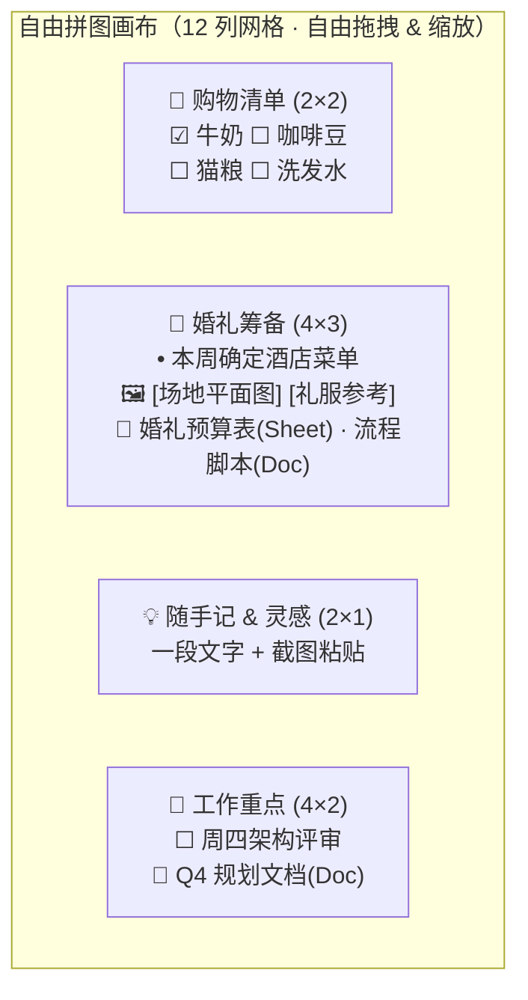
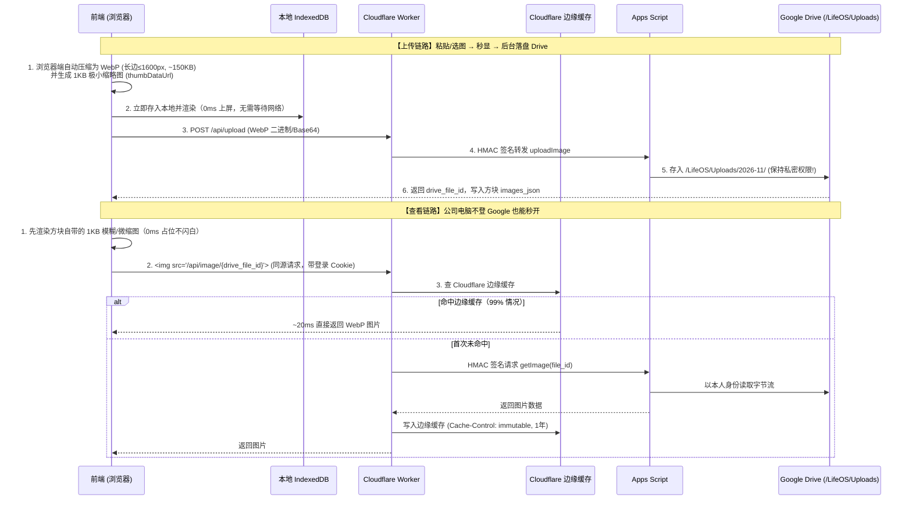

# LifeOS 2.0 ·「自由拼图画布（Bento Canvas）」详细设计方案

> **核心理念**：去掉固定的「总览 / 待办 / 项目」死板栏目，把整个看板变成一块**像桌面小组件 / 拼图一样的自由画布**。任何事情（购物清单、灵感图片墙、婚礼筹备、工作备忘、长期专项）都是画布上的一个**方块（Card / Widget）**——随时新建、随时删除、自由拖拽换位、拉拽边缘缩放大小，点开还能挂载任意 Google Docs / Sheets / Drive 文件。
>
> *注：本轮仅输出架构与交互设计方案，不改动线上代码。*

---

## 一、整体交互与视觉形态（“大拼图”怎么玩）

### 1.1 方块的「双层交互」设计
为了让画布既像拼图一样直观，又能装下丰富内容，每个方块分为两层：

| 层级 | 你看到什么 | 你能直接做什么 |
|---|---|---|
| **第一层：画布缩略态** （拼图表面） | 标题、主题色/图标、正文与清单预览、图片缩略网格、底部关联的 Doc/Sheet 快捷芯片 | • **直接打勾**：像购物清单不用点开弹窗，在方块表面直接点复选框就能打勾完成 • **拖拽换位**：按住方块顶部标题栏任意拖动，其他方块自动让位重新拼合 • **拉拽缩放**：拖动方块右下角缩放手柄，无级改变宽高（支持 `1×1` 到 `12×8` 任意网格尺寸） • **一键跳文档**：点底部的 Doc / Sheet 芯片直接新标签页打开对应 Google 文档 |
| **第二层：展开编辑态** （点击方块主体弹出） | 完整富文本/清单编辑器、高清大图预览与上传区、关联文档管理区、方块设置 | • **图文混排编辑**：自由写文字、插入待办勾选框（`- [ ]`）、加粗/标题/分割线 • **传图**：支持 `Ctrl+V` 直接粘贴截图、拖拽图片进来、或手机拍照/选相册上传 • **挂载 Docs / Sheets**：粘贴已有链接，或点「+ 一键新建关联 Sheet / Doc」 • **外观与隐私**：换卡片底色（莫兰迪色系/深浅色）、标记「敏感（公司电脑隐藏）」、删除方块 |

### 1.2 桌面端 vs 手机端的「拼图自适应」机制
自由网格最容易踩的坑是：**在电脑上摆好的漂亮拼图，在手机窄屏上要么挤成一条缝，要么一拖动就把电脑排版毁了**。我们的解法：

1. **双套坐标，互不破坏**：
   - **电脑端（12 列自由网格）**：使用 `{ x, y, w, h }` 二维坐标，像拼图一样任意摆位置、拉大小。
   - **手机端（2 列 Bento 紧凑网格）**：自动按电脑端的阅读顺序（从上到下、从左到右）排成 **2 列小方块 + 1 列宽方块**；你也可以在手机上单独调整上下顺序（存为 `sm_order`），**不会影响电脑端的二维排版**。
2. **手机防误触锁**：
   - 手机上默认是「浏览/勾选/记事模式」，上下滑动页面绝不会误拖动方块；
   - 点顶部「调整排版」或长按方块标题栏，才进入拖拽排序/缩放模式。

---

## 二、方块内部内容与关联设计（一期范围）

### 2.1 一期不做“几十种复杂组件”，只做「全能自由方块」
为了真正做到**“不限格式”**，一期我们不把方块死板地分成“只能写字的方块”“只能放图的方块”，而是让**每一个新建的方块都天然具备以下 4 个自由组合的能力**（用哪个就显示哪个）：

1. **文字与清单混排区（Text & Checklist）**
   - 支持纯文字段落、小标题、以及可交互的复选框列表（例如购物清单、行李清单、今日待办）。
   - 在编辑器里按回车自动续接下一条清单；在画布表面也能直接点击勾选/取消。
   - 支持「一键清理已勾选」（逛完超市点一下，勾掉的物品自动归档或清除）。
2. **图片区（Images）**
   - 一个方块可上传 1～N 张图片（自动在卡片上排成单图封面、双图并排或九宫格缩略图）。
   - 点击图片可全屏放大查看、写图片备注、或删除。
3. **关联文档与链接区（Linked Docs / Sheets / Drive）**
   - 每个方块底部可挂载多个外部关联项，自动识别类型并展示对应图标：
     - 🟢 **Google Sheets**（如：婚礼预算明细表、宾客排房表）
     - 🔵 **Google Docs**（如：会议纪要、长篇方案）
     - 🟡 **Google Drive 文件夹**（如：合同扫描件目录）
     - 🔗 **任意网页链接**（如：京东/淘宝商品链接、参考帖）
   - **两种关联方式**：
     - **方式 A（粘贴现有链接）**：把任何已有的 Google Doc/Sheet 或网页 URL 贴进去，自动生成快捷芯片。
     - **方式 B（一键生成并绑定）**：在方块里点 **「+ 新建专属 Sheet」** 或 **「+ 新建专属 Doc」** → 后端 Apps Script 自动在你的 Google Drive `/LifeOS/Projects/` 下创建一份对应文件，自动命名为「方块标题 - 附属表格/文档」，并把链接绑回这个方块。
4. **顶部多画布标签（可选的分页/空间，轻量级）**
   - 当方块越来越多时，画布顶部可以像浏览器标签页一样建多个画布（如：`🏠 主画布`、`💍 婚礼`、`💼 工作`），每个画布是一张独立的大拼图；方块也可以在不同画布间一键移动。

---

## 三、图片上传与秒开架构（零费用 + 公司电脑不登 Google 也能看）

这是本方案最核心的技术设计：**图片存在你的 Google Drive 里，但你在公司电脑（未登录个人 Google）上怎么秒开查看？**

### 3.1 为什么不能直接用 Google Drive 的原始图片链接？
- 如果文件设为私密，公司电脑没登你的 Google 账号，直接加载 `drive.google.com` 图片会 `403` 裂图；
- 如果把你的私人照片全设为“知道链接的任何人可读”，既有隐私隐患，而且 Google Drive 经常拦截外站 `` 直链。

### 3.2 解决方案：「前端压缩 + Drive 私密存储 + Cloudflare 同源边缘缓存代理」

**这套图片链路的好处：**
1. **完全免费**：存放在你自己的 Google Drive（15GB 免费空间），在 `/LifeOS/Uploads/` 下按月份归档，你随时能在云端硬盘里直接看到原图。
2. **隐私绝对安全**：Drive 里的图片**不需要开放公开链接**；只有通过你的看板登录密码验证后的请求，Worker 才会代理读取；并且标记了 `sensitive=TRUE` 的方块，在公司电脑模式下连图片 ID 都不会下发。
3. **打开飞快**：
   - 前端上传前自动压成 **WebP（约 100～200KB）**，既省 Drive 空间，又避开 Apps Script 体积限制；
   - 每个图片对象顺带存一个 **1KB 的极小预览串（`thumb`）** 放在表格快照里，打开网页瞬间就有画面；
   - 高清图经过 Cloudflare 边缘缓存后，全球访问只要 **20～50ms**，不会每次都去调慢速的 Apps Script。

---

## 四、Google Sheets 数据表结构升级设计

我们仍然以你已经建好的 **`LifeOS-Core`** Google 表格作为唯一数据源，只需新增两张工作表（`setupSheets` 可一键自动增量创建，不影响已有表）：

### 4.1 `Boards`（画布分页表，极简）
| 字段 | 说明 |
|---|---|
| `id` / `created_at` / `updated_at` / `version` / `deleted` | 通用系统字段 |
| `title` | 画布名称（默认初始化一个 `🏠 主看板`） |
| `icon` / `sort` | 图标 / 排序权重 |
| `sensitive` | `TRUE` 时整张画布在公司电脑模式下隐藏 |

### 4.2 `Cards`（自由拼图方块表 —— 核心）
| 字段 | 类型 | 说明 |
|---|---|---|
| `id` / `created_at` / `updated_at` / `updated_by` / `version` / `deleted` | 系统字段 | ULID 主键、时间戳、版本号、软删除 |
| `board_id` | 文本 | 所属画布 ID（默认 `main`） |
| `title` | 文本 | 方块标题（如：`🛒 超市采购清单`、`💍 婚礼排房`） |
| `color` | 枚举 | 卡片背景主题（`white` / `sky` / `emerald` / `amber` / `rose` / `violet` / `slate`） |
| `layout_json` | JSON 文本 | 拼图坐标与尺寸：`{"x":0,"y":0,"w":3,"h":2,"sm_order":1}`（电脑 12 列网格坐标 + 手机排序） |
| `content_md` | 文本 | 正文与清单内容（支持 Markdown 文本与 `- [ ] ` / `- [x] ` 交互清单；单单元格上限 5 万字） |
| `images_json` | JSON 文本 | 图片数组：`[{"id":"...","file_id":"Drive文件ID","thumb":"data:image/webp;base64,...","caption":"备注","w":1200,"h":900}]` |
| `links_json` | JSON 文本 | 关联文档数组：`[{"id":"...","title":"婚礼预算表","kind":"gsheet","url":"https://...","file_id":"..."}]` |
| `sensitive` | 布尔 | `TRUE` 时在公司电脑登录时不返回该方块 |
| `pinned` | 布尔 | 是否置顶锁定 |

> **布局拖动如何避免频繁写爆 Google Sheets？**
> 当你在画布上拖拽方块或缩放大小时，前端**本地立即丝滑生效并存入 IndexedDB**，然后做 **1.5 秒防抖（Debounce）**，把这一次拖动涉及到的所有方块坐标变化**合并成一次批量 `mutate` 请求**写回 Google Sheets。哪怕你连续摆弄 10 个方块，也只会触发 1 次后端写入。

---

## 五、分步演进建议（在不推翻现有架构的前提下平滑升级）

现有的「Cloudflare Worker + KV 快照 + IndexedDB 离线队列 + Apps Script 签名通信」底层**完全不用推翻**，100% 可以直接复用！只需要在上面升级表和数据层：

1. **Step 1（核心拼图画布 + 自由图文清单方块）**：
   - `gas/Code.gs` 增加 `Boards`、`Cards` 表和 `uploadImage` / `getImage` / `createLinkedDoc` 三个动作；
   - Worker 增加 `/api/upload` 和 `/api/image/:fileId`（带 Cloudflare Cache API 边缘缓存）；
   - 前端换成 **Bento 自由网格画布**：支持新建/删除方块、拖拽换位、拉拽边缘缩放、方块表面直接勾选清单、点开弹窗编辑图文 + 粘贴上传图片 + 绑定/新建 Google Docs & Sheets。
2. **Step 2（进阶微组件，按需再加）**：
   - 如果后续某些方块想要特殊形态（比如「倒计时方块」「嵌入某个 Sheet 指定区域的迷你表格预览方块」「预算进度条方块」），只需要给 `Cards` 表加一个 `widget_type` 字段即可扩展，不需要改画布底座。

---

## 六、已拍板的设计决策（v2.0 定稿）

| # | 决策项 | 最终结论 |
|---|---|---|
| 1 | 页面形态 | **方案 A（纯粹自由拼图画布）**：取消原有的「总览 / 待办 / 项目」死板三栏，打开就是自由拼图大画布；顶部支持多画布标签页（如 `🏠 主看板`、`💍 婚礼`、`💼 工作`） |
| 2 | 方块交互方式 | **方案 A（双层交互）**：画布表面直接勾选清单、点关联文档芯片、拖标题栏换位、拉右下角缩放；点击方块主体弹出大卡片进行文字编辑、传图和管理链接 |
| 3 | 关联 Docs / Sheets | **一期采用粘贴链接**：粘贴已有 Google Docs / Sheets / Drive / 网页链接，自动识别类型并生成图标芯片 |

---

## 七、视觉与动效定稿规范（以 Demo v2 为准）

已通过交互原型确认以下风格与交互标准，后续开发必须严格对齐：

1. **视觉体系（借鉴 `limegreen-studio/bento-you` + `shadcn/ui`）**：
   - **去 AI 感**：禁用彩虹顶部色条、禁用标题 Emoji 堆砌、禁用高饱和渐变与冗余提示横幅；图标统一使用极细线性 SVG（1.5–1.8px stroke）。
   - **画布与卡片**：浅点阵纸面底纹 + `24px` 大圆角卡片 + 极细 1px 边框 + 多层柔和环境阴影；卡片质感克制为 5 种（`default` 纯白 / `warm` 暖纸 / `sage` 鼠尾草 / `mist` 雾蓝 / `ink` 深炭黑）。
   - **操作入口**：顶部仅保留品牌、画布标签页、桌面/手机切换与公司模式；新建操作收进底部居中 **悬浮毛玻璃 Dock 栏**（清单 / 笔记 / 图片 / 关联文档，其中「关联文档」点击在 Dock 上方展开极简胶囊输入框）。
2. **60fps 拖拽与缩放引擎**：
   - 采用持久 DOM + GPU `translate3d`（或 `react-grid-layout`）；拖起方块时外层关闭 transition 实现 1:1 跟手，内层子元素做 `scale(1.028) rotate(0.45deg)` 浮起与加深阴影；
   - 拖动阈值 `5px`（轻点打开编辑、拖过 5px 抓起换位），周围方块 `300ms cubic-bezier(0.22, 1, 0.36, 1)` 实时滑开让位，底下显示 `24px` 圆角虚线落点框；
   - 缩放同时支持**悬停底部黑底快捷尺寸胶囊（`S / M / W / L`）**与**右下角任意拖拽缩放**；手机端默认锁定拖拽防止与滑动冲突。

